<a href="https://www.iamrupambiswas.com">
  
</a>

<p align="left">
  <a href="https://www.iamrupambiswas.com"></a>
  <a href="https://www.linkedin.com/in/iamrupambiswas"></a>
  <a href="https://leetcode.com/iamrupambiswas"></a>
  <a href="mailto:rupambiswas953@gmail.com"></a>
  <a href="https://www.iamrupambiswas.com/Resume.pdf"></a>
</p>

Hi, I'm **Rupam**, a full-stack developer in Bangalore working with **Next.js, Spring Boot and AWS**.
I build things that hold up in production: payment flows that don't double-charge, queues that don't lose messages, and pipelines that ship on time.

```console
➜  ~ whoami
  2+      years running code in production
  Java 21 daily driver, with Spring Boot 3
  400+    DSA problems solved
  8.6     CGPA, BCA (because someone will ask)
```

### `01 / ABOUT`

**The short version: I like owning the whole thing.**

I like the parts of software most people hope someone else will handle: payment retries, request signing, message queues, and the deploy pipeline that has to work at 6 p.m. on a Friday. At work I build travel insurance and claims platforms and own features end to end, from the React/Next.js screen to the Spring Boot services behind it, the CI/CD that ships it, and the dashboards I watch afterwards. After work I'm building Sentinel AML in public, because apparently one production system wasn't enough.

```json
{
  "name": "Rupam Biswas",
  "based_in": "Bangalore",
  "latest_ship": "Sentinel AML",
  "favorite_bug": "the one that only happens in prod",
  "hobbies": ["swimming", "sketching", "leetcode"],
  "fuel": "green CI pipelines",
  "open_to": "full-stack / backend java roles"
}
```

### `02 / GIT LOG --CAREER`

```diff
* commit a1f9c2e  (HEAD -> main)
| Junior Full-Stack Developer @ Asego Global Assistance     Nov 2025 — Present · Bangalore
| "If it runs in production, it's probably my problem."  · travel insurance & claims platforms
+ Scaled a partner's consumer portal to 10x daily customers
+ Migrated a live production portal with zero downtime
+ Idempotent payment workflows + reconciliation that issues a policy for every successful payment
+ IP-based API rate limiting with Redis + atomic Lua scripts, guarding public endpoints in prod
+ Claim registration & settlement workflows with third-party claim partner integrations
+ Event-driven integrations on ActiveMQ + Spring JMS; partner APIs secured with encryption & signed requests
+ Sales analytics microservices (Next.js, Spring Boot) with AI summaries from Google Gemini
+ Watch production in Grafana and fix the critical issues when it pages
|
* commit 7c03b1d
| Software Technical Associate @ Home Triangle              Jul 2024 — Nov 2025 · Bangalore
| "Where I learned that 'quick fix' is a lie."
+ Onboarding, vendor-management and admin modules with React, Spring Boot, Spring Security, MySQL
+ REST APIs covered with JUnit + Mockito; JPA/Hibernate for data access
+ Geofencing (Haversine) + Firebase Cloud Messaging to cut vendor response time
+ Redis caching and query tuning on high-traffic workflows
```

### `$ git log sentinel-aml --oneline`

<sub>Building <a href="https://github.com/iamrupambiswas/sentinel-aml">Sentinel AML</a> in public — one phase at a time, written up on <a href="https://www.linkedin.com/in/iamrupambiswas">LinkedIn</a>.</sub>

```diff
+ p6  Keycloak auth · JWT checked at the gateway AND in every service · deny-by-default roles
+ p5  Race-free alert de-dup · live rule tuning in 45 ms over an ActiveMQ topic · DLQ replay
+ p4  Real-time detection engine · 6 AML typologies · Redis + Lua sliding windows · ~19 ms/txn
+ p3  Hardened Spring Batch ingestion · skip listeners · crash reconciliation on boot
+ p2  AES-encrypted PII · multi-module Maven + BOM · MDC trace IDs · Flyway per service
+ p1  System design · bounded contexts · database-per-service
! p7  next: the analyst console, server-side login, alerts that arrive live
```

### `03 / ARCHITECTURE`

<sub>`GET /request` → follows it through every layer I work in ↓</sub>

| Layer | | Stack |
|---|---|---|
| **L1 · client** | *Pixels that behave themselves.* |       |
| **L2 · api** | *Where the business logic pays rent.* |        |
| **L3 · data** | *Remembers things so users don't have to.* |       |
| **L4 · infra** | *"Works on my machine" → works on every machine.* |         |
| **L5 · obs** | *Graphs I stare at during incidents.* |       |
| **L6 · ai** | *Robots that write the boring parts.* |       |

### `04 / SELECTED WORK`

**Projects I built because tutorials weren't enough.**

<table>
  <tr>
    <td valign="top" width="33%">
      <sub><code>project_01</code></sub><br/>
      <a href="https://github.com/iamrupambiswas/sentinel-aml"><b>Sentinel AML</b></a><br/>
      <i>Catching money launderers in milliseconds, not weeks.</i>
      <br/><br/>
      Cloud-native, event-driven anti-money-laundering platform. Scores transactions in real time and gives analysts explainable alerts with a tamper-proof case trail.
      <br/><br/>
      ▹ 5 Spring Boot microservices<br/>
      ▹ Real-time rule engine + risk scores<br/>
      ▹ Hash-chained audit log<br/>
      ▹ Live alerts over SSE
      <br/><br/>
      <sub>Java · Spring Boot · Spring Cloud · Next.js · ActiveMQ · Redis · MySQL · Keycloak · Terraform · AWS</sub>
    </td>
    <td valign="top" width="33%">
      <sub><code>project_02</code></sub><br/>
      <a href="https://github.com/iamrupambiswas/Project-Management-Tool"><b>ProjectFlow</b></a><br/>
      <i>Jira, minus the existential dread.</i>
      <br/><br/>
      AI-assisted project management on AWS. A Spring AI + OpenAI assistant turns vague tasks into step-by-step plans, so standups get shorter.
      <br/><br/>
      ▹ AI task assistant<br/>
      ▹ JWT auth + RBAC<br/>
      ▹ CSV bulk onboarding<br/>
      ▹ Flyway-managed schema
      <br/><br/>
      <sub>Java · Spring Boot · Spring AI · React · TypeScript · PostgreSQL · Docker · GitHub Actions · AWS</sub>
    </td>
    <td valign="top" width="33%">
      <sub><code>project_03</code></sub><br/>
      <a href="https://github.com/iamrupambiswas/Doctor-Apointment-Booking"><b>Doctor Appointment Booking</b></a><br/>
      <i>Booking a doctor, without the phone tag.</i>
      <br/><br/>
      Full-stack booking system with separate patient, doctor and admin roles, dynamic routing and JWT-secured sessions. Pick a slot, book it, done.
      <br/><br/>
      ▹ Role-based access<br/>
      ▹ JWT sessions<br/>
      ▹ Slot booking flow<br/>
      ▹ <a href="https://my-doctor-appointment-booking.vercel.app">Live on Vercel ↗</a>
      <br/><br/>
      <sub>React · Node.js · Express · MongoDB · TailwindCSS · JWT</sub>
    </td>
  </tr>
</table>

### `05 / CREDENTIALS`

| | | |
|---|---|---|
| `DEGREE` | **Bachelor of Computer Applications (BCA)** | Indian Academy Degree College (Autonomous) · 2021 — 2024 · CGPA 8.6 |
| `CERTIFICATE` | **Master DevOps with AI, AWS, GCP & GitOps** | Udemy · 2026 · pipelines, IaC, and a lot of YAML |
| `CERTIFICATE` | **Java, Spring Boot 3, Microservices & Spring AI** | Udemy · 2025 · services that talk to each other and to LLMs |
| `CERTIFICATE` | **MongoDB Schema Design skill badges** | MongoDB · 2025 · patterns, antipatterns, and SQL → documents |
| `ACHIEVEMENT` | **[400+ DSA problems solved ↗](https://leetcode.com/iamrupambiswas)** | LeetCode · GeeksforGeeks · HackerRank |

### `06 / STATS`

<p align="left">
  
  
</p>

### `07 / CONTACT`

**Let's ship something good.** Hiring, collaborating, or stuck on a bug at 2 a.m.? My inbox is open — I reply faster than most CI pipelines.

```console
$ mail rupambiswas953@gmail.com
```

<sub>more at <a href="https://www.iamrupambiswas.com">iamrupambiswas.com</a> · built with green CI pipelines</sub>
